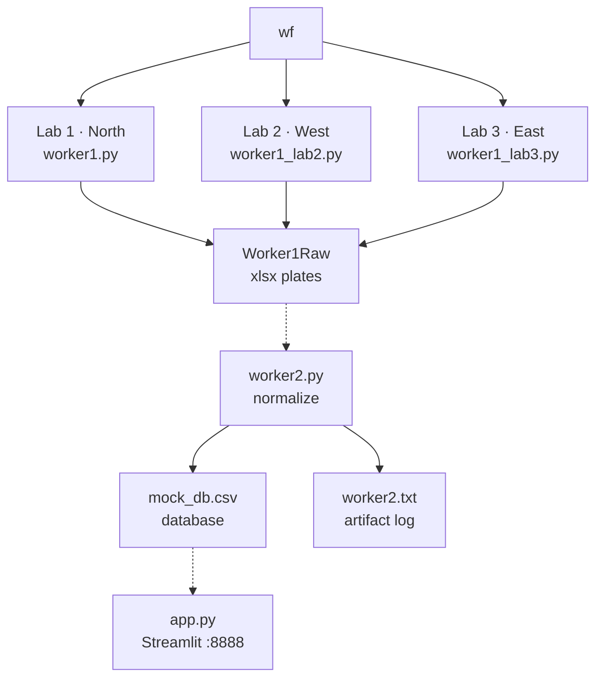

# Assay plate pipeline

Three Domino jobs write 96-well Excel plates. Worker 2 canonicalizes them into a CSV database. A Streamlit app browses that file. The shared plate contract lives in `worker1.py`.

| | |
| --- | --- |
| Lab writers in `workflow.py` | 3 |
| Wells written per plate | 96 |
| Plates in the checked-in CSV | 10 |
| Breaks on the live path | 2 |

**Lab 1 plates never reach the database.** `worker1.py` writes North Lab and a run date, and leaves C2 empty. `worker2.py` rejects any plate missing an instrument, so every Lab 1 file is logged as skipped.

**Worker 2 and the app are outside the workflow.** `workflow.py` starts Lab 1, Lab 2, and Lab 3 in parallel and stops. Nothing launches `worker2.py`. `app.sh` starts Streamlit on port 8888 as a separate Domino app.

## Data flow

Solid boxes are tasks in `workflow.py`. Dashed boxes are in the repo and started by hand. Lines are data flow, not Flyte dependencies. Worker 2 is not an edge from the workflow.

## What each piece does

Lab writers share one workbook builder, then Lab 2 and Lab 3 dirty the sheet the way a real plate reader or a hand entry would. Worker 2 walks every `.xlsx` under the raw mount, accepts a plate or skips it, and appends 96 rows.

### Lab writers (scheduled)

- Lab 1 writes a clean North Lab plate to `Worker1Raw/lab1`. Filename `assay_plate_YYYY-MM-DD_INITIALS_id.xlsx`.
- Lab 2 rewrites names into reader shorthand, sets West Lab and BioTek Synergy H1, and plants overflow, blank, and text wells. Folder `lab2`.
- Lab 3 mimics hand entry: typos, a trailing space, decimal commas, units, `#N/A`, and a note in A14. Folder `lab3`.

### worker2.py (manual)

Reads `/mnt/data/Worker1Raw`. Canonicalizes project, serum, parameter, lab, day, and date. Maps the analyst letter back to the initials roster. Appends accepted wells to `/mnt/data/Worker2DatabaseProxy/mock_db.csv`. One plate is one identity, not one filename.

### app.py (separate app)

Streamlit on `0.0.0.0:8888` via `app.sh`. Opens only the mounted CSV, not the copy in the repo. Requires project, lab, run date, and serum before it shows wells. Extra filters and a well box (`A7` or `A`) narrow the same rows.

## Compliance checks

A failed check skips the whole plate. Flagged wells still land in the database with an empty value and a flag.

| Check | Where | Result |
| --- | --- | --- |
| Project, serum, parameter, initials on the Lab 1 lists | `worker2` `plate_rows` | Skip. Lists are generated once in `worker1.py` (7 projects, 4 serums, 7 parameters, 10 initials). |
| Serum and parameter aliases, `Domino-#######` project form | `worker2` `canon_*` | Rewrite, then re-check the allowed list. Typos such as Serun and shorthand such as FBS or OD450 map back. |
| Lab name | `worker2` `LABS` | North Lab and lab1 become Lab1. West Lab becomes Lab2. East Lab becomes Lab3. Blank lab skips the plate. |
| Day is `day N`, N at least 1 | `worker2` `canon_day` | Skip. Stored as `day N`. |
| B2 analyst letter matches the initials roster (A through J) | `worker2` + `analyst_letter` | Skip on mismatch. |
| Instrument in C2 and a run date | `worker2` `plate_rows` | Skip if either is empty. Date is read from C3, then from the filename (`YYYY-MM-DD` or `MMDDYYYY`). |
| Row labels A–H | `worker2` `plate_rows` | Skip if a row letter is wrong. Lab 3’s lowercase `a` is accepted after uppercasing. |
| Well is a number, overflow, blank, or missing | `worker2` `parse_well` | Overflow, blank, and NA become flags and an empty value. The plate is still accepted. |
| Units and a trailing percent are stripped; comma is the decimal mark | `worker2` `parse_well` | `1.234,5` is rejected. A mix of comma and period skips that well’s plate. |
| Plate identity already stored | `worker2` `duplicate_reason` | Skip. Identity is project, serum, parameter, initials, lab, day, and run date. |
| Header cells and 96 numeric wells after Lab 1 writes | `worker1` `assert_layout` | The Lab 1 job fails its own assert. It does not check C2. |
| Dirty export matches the lab script | lab2 and lab3 `main` | Each job reloads the xlsx and asserts the messy cells before it exits. |
| Ingest rules, log line, and column migration | `worker2` `_self_check` | Runs at the start of every worker2 job, before any real file is read. A failed assert aborts the run. |

Flag tokens: `OVRFLW`, `OVERFLOW`, `****`, blank, `#N/A`, `#DIV/0!`, `ND`, `N.A.`, `NA`.

## Database and logs

### mock_db.csv

Runtime path `/mnt/data/Worker2DatabaseProxy/mock_db.csv`. Worker 2 creates it, adds missing columns, and appends. There is no transaction and no delete.

Columns, including the spellings the app expects: `project`, `serums`, `PARAMETERS`, `initals`, `cell`, `value`, `lab`, `instrument`, `run_date`, `flag`, `day`, `analyst`.

The file in the repo is a seed: 960 rows, 10 plates, 96 wells each, and only the first six columns. The app will refuse it until `lab` and `run_date` exist, and the app does not open this path.

### worker2.txt

Append-only log at `/mnt/artifacts/worker2.txt`. One line per file: timestamp, filename, plate identity, then accepted, accepted with a flagged-well count, or skipped plus the reason.

Lab jobs do not write this file. They print the saved xlsx path to job stdout. The Streamlit app logs only in the UI.

No rotation, no second log, and no record of which filename was ingested. A second file with the same plate identity is a duplicate skip.

## Plate contract

Every lab starts from `build_workbook`. Worker 2 reads the same cells. This layout is the interface between the jobs.

| Cell | Meaning | Who fills it |
| --- | --- | --- |
| A1 | Project, `Domino-` plus 7 digits | All labs. Lab 2 drops the hyphen; worker 2 puts it back. |
| A2 | Serum | Lab 1 uses the full name. Lab 2 uses shorthand. Lab 3 uses typos and odd case. |
| A3 | Parameter | Same split. Lab 2 writes OD450, RFU, ng/ml, % inhibition. |
| A4 | Initials, two letters | Lab 2 lowercases them. Lab 3 adds a trailing space. |
| B1 / B2 | Day and analyst letter | Day 1–3. Letter is the roster index, A for the first initials. |
| C1 / C2 / C3 | Lab, instrument, run date | Lab 1 sets lab and date only. Lab 2 and Lab 3 set all three. |
| C4 / A14 | Extra lab notes | `endpoint`, `1:100`, or a free-text note. Worker 2 ignores them. |
| Rows 5–12 | 96 wells, columns 1–12 | Row letter in column 1. Values in columns 2–13. |

## On the path

| Piece | Role | Reads | Writes |
| --- | --- | --- | --- |
| `workflow.py` | Flyte workflow, three `DominoJobTask`s, no data passed between them | Project files | Lab 1, Lab 2, Lab 3 jobs |
| `worker1.py` | Vocabulary, plate builder, Lab 1 writer | In-code lists | `/mnt/data/Worker1Raw/lab1` |
| `worker1_lab2.py` | West Lab dirty export | `build_workbook` | `/mnt/data/Worker1Raw/lab2` |
| `worker1_lab3.py` | East Lab dirty export | `build_workbook` | `/mnt/data/Worker1Raw/lab3` |
| `worker2.py` | Ingest, compliance, append | Every xlsx under `Worker1Raw` | `mock_db.csv` and `worker2.txt` |
| `app.py` + `app.sh` | Filter and show wells | Mounted `mock_db.csv` | Browser on port 8888 |

## Gaps and leftovers

| Gap | Why it matters |
| --- | --- |
| `workflow.py` never starts `worker2.py` | Plates sit in `Worker1Raw` until someone runs the normalizer. |
| Lab 1 omits the instrument | Worker 2 skips those files. Only West and East plates can be accepted. |
| App and seed CSV disagree | `app.py` requires `lab` and `run_date`. The repo CSV has six columns and is not the path the app opens. |
| Dockerfile is only a base image | Python 3.12-slim plus openpyxl and streamlit. No `COPY`, no command, no port. Domino is expected to run the project files. |
| `flytekit` is not in `requirements.txt` | `workflow.py` imports `flytekit` and `flytekitplugins.domino`. Those come from the Domino environment, not this file. |
| `add.py` and `sqrt.py` | Domino samples. They read `/workflow/inputs` and write `/workflow/outputs`. Nothing in the assay workflow calls them. |
| Startup self-check in worker 2 | `main()` proves the parser before it touches the dataset. A broken assert means zero plates ingested. |
| No auth, scheduler, or file ledger | The app is an open Streamlit filter. Runs are manual. Dedup is plate identity, not filename. |

## Mounts

- `/mnt/data/Worker1Raw` holds `lab1`, `lab2`, and `lab3`.
- `/mnt/data/Worker2DatabaseProxy` holds the live CSV.
- `/mnt/artifacts/worker2.txt` is the ingest log.
- `/workflow/inputs` and `/workflow/outputs` belong only to `add.py` and `sqrt.py`.
